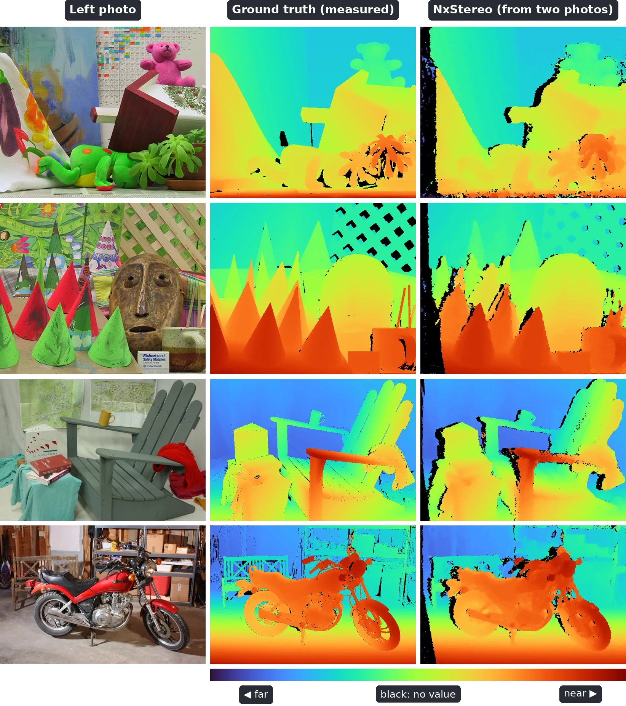

# NxStereo

Semi-global stereo matching for [Nx](https://github.com/elixir-nx/nx).

```elixir
disparity = NxStereo.sgm(left, right, disparities: 64, p1: 8, p2: 64)
```

`left` and `right` are rectified `{height, width}` `u8` images; the result is
an `f32` disparity map with `-1.0` where no reliable match was found. The
algorithm is libSGM's: a 9x7 Census transform, Hamming costs, three
aggregation paths with the normalized recurrence, winner selection with a
uniqueness check and parabolic subpixel refinement, OpenCV's left-right
consistency check and a 3x3 median.

`:disparities` is 64 or 128, and images are at most 4096 pixels wide. When
nearby objects shift by more than 128 pixels between the two images, run on
downscaled images.

## What runs where

`NxStereo.sgm/3` is plain Nx. How it runs depends on the compiler that calls
it:

| Called through | Runs on | Needs |
| --- | --- | --- |
| Nx alone (`Nx.Defn.Evaluator`) | CPU, in Elixir; correct but far too slow for video | `nx` |
| `EXLA` | CPU, or CUDA GPUs, as XLA code | `exla` |
| `NxIREE.Compiler` for Vulkan | Vulkan GPUs, as the shaders in `priv/spirv` | `nx_iree`, plus `exla` where it compiles |

Only `NxIREE.Compiler` uses the shaders; every other compiler or backend runs
the Nx implementation. All three give the same matches; subpixel values from
the shaders may differ in their last bit.

The libraries play these roles:

  * `nx_stereo`: the algorithm in Nx, and its Vulkan shaders.
  * `exla`: turns Nx code into StableHLO, which NxIREE compiles. Only
    needed on the machine that compiles.
  * `nx_iree`: a compiler, `iree-compile`, that builds GPU programs on the
    compiling machine, and a small runtime that runs them on the device.

## Installation

```elixir
def deps do
  [
    {:nx_stereo, github: "Spin42/nx_stereo"},
    # for Vulkan GPUs; NxStereo falls back to plain Nx without it
    {:nx_iree, github: "Spin42/nx_iree"},
    # only where functions are compiled
    {:exla, "~> 1.0"}
  ]
end
```

`nx_iree` is an optional dependency of `nx_stereo`, so it must be listed
explicitly. Its first build compiles the IREE runtime and needs `git`,
`cmake`, `ninja` and a C++17 compiler. NxIREE detects EXLA when it is
compiled: after adding `exla` to a project where `nx_iree` is already built,
run `mix deps.compile nx_iree --force`, or compiling for Vulkan fails.

## Running on a GPU

When one machine compiles and runs:

```elixir
sgm =
  Nx.Defn.jit(&NxStereo.sgm(&1, &2, disparities: 64),
    compiler: NxIREE.Compiler,
    iree_compiler_flags: ["--iree-hal-target-backends=vulkan-spirv"],
    iree_runtime_options: [device: device]
  )

disparity = sgm.(left, right)
```

  * `device` is one of `NxIREE.list_devices("vulkan")`. Without it NxIREE
    uses the first GPU it finds, which may be an integrated one.
  * The first call for each image size compiles for a few seconds. For
    video, build `sgm` once per resolution and call it for every frame.
  * The result stays on the GPU. `Nx.backend_transfer/2` copies it to the
    CPU; passing it to another NxIREE call needs no copy.

The GPU needs Vulkan 1.1 with subgroup shuffles and a subgroup size of at
least 8 for 64 disparities or 16 for 128.

## Running on a device without the compiler

A device can run the shaders with only `nx`, the `nx_iree` runtime and a
Vulkan driver. Compile on another machine with `NxIREE.export/3`, for the
image size the device will use:

```elixir
# compiling machine
template = Nx.template({480, 640}, :u8)

binary =
  NxIREE.export(&NxStereo.sgm(&1, &2, disparities: 64), [template, template],
    iree_compiler_flags: ["--iree-hal-target-backends=vulkan-spirv"]
  )

File.write!("sgm.bin", binary)

# device
sgm = NxIREE.load_exported(File.read!("sgm.bin"), device: device)
disparity = NxIREE.run(sgm, [left, right])
```

NxIREE's module cache works too: it keeps `NxStereo.sgm/3` calls unchanged on
the device, which then needs `nx_stereo` as well. See NxIREE's documentation
for both, and for cross-compiling with Nerves.

## Shaders

The GLSL sources in `shaders/` are ported from
[Fixstars libSGM](https://github.com/fixstars/libSGM) (Apache-2.0) and
OpenCV's StereoSGBM consistency rules (BSD-3-Clause, see `OPENCV-LICENSE`).
The six stages are the Census transform, the forward, reverse and vertical
cost scans (the last one also selects the winners), the consistency check and
the median. Image size and penalties are specialization constants, so the
SPIR-V in `priv/spirv` is compiled once per stage and disparity range;
`mix nx_stereo.shaders` regenerates it with `glslangValidator`.

## Tests

`mix test` checks the reference implementation on EXLA and Nx's evaluator.
`mix test --include vulkan` also compares the shaders with it on every
Vulkan device (`NX_STEREO_DEVICE` selects devices by URI substring).

## Benchmark

`mix run bench/datasets.exs` downloads the Middlebury MiddEval3 training
scenes into `_build/bench` and reports, per scene, the share of pixels
matched and of pixels more than 2 disparities off. On a Vulkan device it also
counts the pixels where the shaders and the reference disagree, and times a
frame. `--datasets middlebury,eth3d,kitti` adds ETH3D (needs `7z`) and KITTI
2015 (1.7 GB); `--device` selects a Vulkan device by URI substring.

## Examples



The ground truth was measured with structured light; NxStereo
(`NxStereo.sgm/3`, 64 disparities, default options) only sees the two
photos, so it loses detail at object edges, in structures thinner than its
9x7 window and on blank or repetitive surfaces, and leaves the left border
and occluded pixels without a value.
The scenes are Teddy and Cones from the Middlebury 2003 datasets, and
Adirondack and Motorcycle from the 2014 datasets at quarter resolution:

| Scene | Pixels matched | Matched pixels off by more than 2 px |
| --- | --- | --- |
| Teddy | 92% | 6.4% |
| Cones | 91% | 5.5% |
| Adirondack | 94% | 5.5% |
| Motorcycle | 94% | 7.5% |

The images come from the [Middlebury stereo datasets](https://vision.middlebury.edu/stereo/data/):
D. Scharstein and R. Szeliski, *High-accuracy stereo depth maps using
structured light*, CVPR 2003; D. Scharstein et al., *High-resolution stereo
datasets with subpixel-accurate ground truth*, GCPR 2014.
