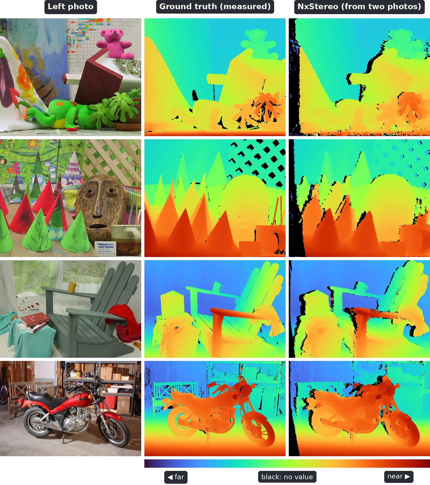

# NxStereo

Semi-global stereo matching for [Nx](https://github.com/elixir-nx/nx).

```elixir
disparity = NxStereo.sgm(left, right, disparities: 64, p1: 8, p2: 64)
```

`left` and `right` are rectified `{height, width}` `u8` images (or `s32` ones
holding 8-bit pixels, for a GPU without 8-bit storage); the result is
an `f32` disparity map with `-1.0` where no reliable match was found. The
algorithm follows libSGM: a 9x7 Census transform that ignores one-level
differences, so that sensor noise on dark or flat surfaces does not count as
texture, Hamming costs, eight aggregation paths with the normalized
recurrence, winner selection with a uniqueness check and parabolic subpixel
refinement, OpenCV's left-right consistency check and a 3x3 median. For
faster frames, see [Speed or accuracy](#speed-or-accuracy).

`:disparities` is 64 or 128, and images are at most 4096 pixels wide. When
nearby objects shift by more than 128 pixels between the two images, run on
downscaled images.

## Coarse to fine

Searching 128 disparities at full resolution costs twice as much as 64.
`NxStereo.sgm_coarse_to_fine/3` gets most of the full search's matches for a
fraction of that:

```elixir
disparity = NxStereo.sgm_coarse_to_fine(left, right, disparities: 128, band: 16)
```

It matches the pair shrunk 2x over 64 disparities with `sgm/3`, then matches
the full-size pair with `NxStereo.sgm_band/4`, which searches each pixel
only within a band of `:band` disparities (8, 16, 32 or 64). A pixel's band
starts `:margin` disparities below twice the lowest coarse disparity in its
3x3 neighbourhood at the coarse scale, so a pixel on a depth edge covers
both sides. `:coarse_paths` sets the coarse matching's paths (3 or 8)
separately from the fine one's: the band only has to contain the right
disparity, so 3 coarse paths lose little. Images need an even height and
width.

On the 2006 Middlebury pairs at half size (6 scenes), pixels both matchings
match agree with the full 128-disparity `sgm/3` within 1 pixel:

| Matching | Agreement with the full search |
| --- | --- |
| Coarse to fine, band 16 | 96.0–99.8% |
| Full search on the pair shrunk 2x | 86–99.4% |

A structure too thin to survive the shrink can take the background's
disparity.

`sgm_band/4` is usable on its own, with a band base from any earlier
estimate: an `s32` `{height, width}` tensor, `-1` where a pixel has no
estimate and should get no match.

## Around the matcher

The steps before and after matching are Nx functions too, so a whole depth
pipeline compiles into one function:

  * `NxStereo.Rectify`: undistortion and rectification, as OpenCV's
    `initUndistortRectifyMap` and `remap`, with the calibration as inputs.
  * `NxStereo.Image`: area resizing, a 3x3 or 5x5 median and the turbo
    colour map.
  * `NxStereo.Depth`: metric depth and a point cloud from a disparity map.

## What runs where

`NxStereo.sgm/3`, `sgm_band/4` and `sgm_coarse_to_fine/3` are plain Nx. How
they run depends on the compiler that calls them:

| Called through | Runs on | Needs |
| --- | --- | --- |
| Nx alone (`Nx.Defn.Evaluator`) | CPU, in Elixir; correct but far too slow for video | `nx` |
| `EXLA` | CPU, or CUDA GPUs, as XLA code | `exla` |
| `NxIREE.Compiler` for Vulkan | Vulkan GPUs, as the shaders in `priv/spirv` | `nx_iree`, plus `exla` where it compiles |

Only `NxIREE.Compiler` uses the shaders; every other compiler or backend runs
the Nx implementation. All three give the same matches; subpixel values from
the shaders may differ in their last bit.

The libraries play these roles:

  * `nx_stereo`: the algorithm in Nx, and its Vulkan shaders.
  * `exla`: turns Nx code into StableHLO, which NxIREE compiles. Only
    needed on the machine that compiles.
  * `nx_iree`: a compiler, `iree-compile`, that builds GPU programs on the
    compiling machine, and a small runtime that runs them on the device.

## Installation

```elixir
def deps do
  [
    {:nx_stereo, github: "Spin42/nx_stereo"},
    # for Vulkan GPUs; NxStereo falls back to plain Nx without it
    {:nx_iree, github: "Spin42/nx_iree"},
    # only where functions are compiled
    {:exla, "~> 1.0"}
  ]
end
```

`nx_iree` is an optional dependency of `nx_stereo`, so it must be listed
explicitly. Its first build compiles the IREE runtime and needs `git`,
`cmake`, `ninja` and a C++17 compiler. NxIREE detects EXLA when it is
compiled: after adding `exla` to a project where `nx_iree` is already built,
run `mix deps.compile nx_iree --force`, or compiling for Vulkan fails.

Installing `nx_stereo` needs no shader compiler: the SPIR-V binaries in
`priv/spirv` are committed (see [SPIR-V binaries](#spir-v-binaries)).

## Running on a GPU

When one machine compiles and runs:

```elixir
sgm =
  Nx.Defn.jit(&NxStereo.sgm(&1, &2, disparities: 64),
    compiler: NxIREE.Compiler,
    iree_compiler_flags: ["--iree-hal-target-backends=vulkan-spirv"],
    iree_runtime_options: [device: device]
  )

disparity = sgm.(left, right)
```

  * `device` is one of `NxIREE.list_devices("vulkan")`. Without it NxIREE
    uses the first GPU it finds, which may be an integrated one.
  * The first call for each image size compiles for a few seconds. For
    video, build `sgm` once per resolution and call it for every frame.
  * The result stays on the GPU. `Nx.backend_transfer/2` copies it to the
    CPU; passing it to another NxIREE call needs no copy.

The GPU needs Vulkan 1.1 with subgroup shuffles and a minimum subgroup size
of 8 for `sgm/3` over 64 disparities, 16 over 128, and `band / 4` for
`sgm_band/4`.
It needs no 8-bit storage buffers when the images are `s32`: every shader
reads and writes 32-bit words.

### Speed or accuracy

`NxStereo.sgm/3` aggregates along 8 paths by default. `paths: 3` keeps only
the horizontal and top-to-bottom paths, for about half the GPU time per
frame. In the `Nx.Defn.jit/2` call above, pass:

```elixir
&NxStereo.sgm(&1, &2, disparities: 64, paths: 3)
```

It leaves more pixels wrong or missing, mostly on dark or textureless
surfaces. On the [benchmark](#benchmark):

| Pixels wrong or missing | 8 paths (default) | 3 paths |
| --- | --- | --- |
| Middlebury | 12.4% | 13.0% |
| ETH3D | 8.7% | 11.4% |
| KITTI | 6.4% | 7.1% |

For 128 disparities, [coarse to fine](#coarse-to-fine) is the bigger saving;
`:paths` and `:coarse_paths` trade speed for accuracy there the same way.

## Running on a device without the compiler

A device can run the shaders with only `nx`, the `nx_iree` runtime and a
Vulkan driver. Compile on another machine with `NxIREE.export/3`, for the
image size the device will use:

```elixir
# compiling machine
template = Nx.template({480, 640}, :u8)

binary =
  NxIREE.export(&NxStereo.sgm(&1, &2, disparities: 64), [template, template],
    iree_compiler_flags: ["--iree-hal-target-backends=vulkan-spirv"]
  )

File.write!("sgm.bin", binary)

# device
sgm = NxIREE.load_exported(File.read!("sgm.bin"), device: device)
disparity = NxIREE.run(sgm, [left, right])
```

NxIREE's module cache works too: it keeps `NxStereo.sgm/3` calls unchanged on
the device, which then needs `nx_stereo` as well. See NxIREE's documentation
for both, and for cross-compiling with Nerves.

## How the shaders work

Each matching function wraps its Nx implementation in an `Nx.block`. When
`NxIREE.Compiler` compiles for Vulkan, the block becomes an
`NxIREE.Vulkan.Pipeline` (built in `NxStereo.Vulkan`): a sequence of compute
dispatches, each a SPIR-V shader from `priv/spirv`, with the buffers between
them kept on the GPU. Every other compiler runs the block's Nx
implementation, which is also the reference the shaders are tested against.

The shaders share a few layouts:

  * **Census features.** A pixel's left and right 9x7 Census signatures sit
    side by side in one 128-bit element, stored in tiles of 8 consecutive
    rows per column, so a scan's step reads one contiguous run.
  * **Path volumes.** A path's cost for a pixel and disparity is one byte,
    four to a 32-bit word. The normalized recurrence keeps each value at or
    below the Census bound plus P2, 127 (which is why `:p2` is at most 79),
    so two paths' sum still fits in a byte: paired scans add their partner's
    volume to their own, and the selection reads half as many volumes.
  * **Band costs.** `sgm_band/4`'s Census distances are below 64, so a
    pixel's candidates are packed 6 bits each (3 words for a band of 16).

### `sgm/3`

| Stage | Shader | What it does |
| --- | --- | --- |
| Census | `census_pair.comp` | Both images' 9x7 Census transforms. A workgroup loads its window into shared memory; a thread computes four consecutive pixels of a row, reading each window row once for the four. A neighbour counts as darker only when it is more than one level below the centre. |
| Forward scan | `cost_first.comp` | The left-to-right path. Computes the Hamming matching costs from a sliding Census window in registers, stores them for the other scans, and stores its path. |
| Reverse scan | `cost_scan.comp` | The right-to-left path over the stored costs, written as the sum with the forward path. |
| Other scans (8 paths) | `cost_line.comp` | Bottom-to-top, top-to-bottom and the four diagonals, one line per lane group, in pairs whose sums go into one volume each. |
| Selection (8 paths) | `select.comp` | Sums the four paired volumes per pixel, picks the lowest-cost disparity, applies the uniqueness check and the parabolic subpixel refinement, and writes the winner's key for the consistency check. |
| Top-to-bottom scan and selection (3 paths) | `cost_line.comp` with `SELECT` | The last scan adds its path to the horizontal sum and selects there, without storing a volume. |
| Consistency | `consistency_projected.comp` | OpenCV SGBM's rule: each row's winners are projected into a pseudo right disparity map in shared memory, and a left match is dropped when the right map disagrees by more than one disparity. |
| Median | `filter.comp` | libSGM's 3x3 median selection network. |

The scans follow libSGM: a line's disparities are spread over 8 or 16 lanes
of a subgroup, 8 disparities each, and the recurrence's neighbours across
lanes arrive through subgroup shuffles. `cost_dp.glsl` holds the
recurrence, `cost_select.glsl` the selection.

### `sgm_band/4`

A pixel's candidates are the `:band` disparities from its base, and
neighbouring pixels' bands differ, so the scans hold each line's whole band
in a thread's registers instead of spreading it over lanes.

| Stage | Shader | What it does |
| --- | --- | --- |
| Census | `census_pair.comp` | As in `sgm/3`. |
| Costs | `band_cost.comp` | Each pixel's matching costs for its band, once for every path, packed 6 bits a candidate. A workgroup covers 4 rows of 64 pixels and loads the right Census of every column they reach into shared memory once. |
| Transpose | `band_transpose.comp` | A column-major copy of the costs with each pixel's base appended, so a horizontal scan's lines are consecutive in memory, as a vertical scan's are. |
| Scans | `band_scan.comp` | The path recurrence, a thread per line. At each step the previous pixel's costs move to the new pixel's band through a barrel shifter over their packed bytes, so every array index stays constant and the band stays in registers; a candidate the previous band lacks costs P2. The reverse horizontal scan adds the forward one's path, and with 8 paths each dispatch scans two directions. On an image at least as wide as it is high, a thread follows a diagonal to the image's side and continues on the one that enters there, so no thread runs outside the image. |
| Selection | `band_select.comp` | `band / 4` lanes per pixel, each summing one word of the paths; the winner, the second best and the winner's neighbours are combined across those lanes with shuffles. Writes the same winner keys as `sgm/3`. |
| Consistency, median | `consistency_projected.comp`, `filter.comp` | As in `sgm/3`. |

`band_common.glsl` holds the band's layouts. A pixel with a negative base is
searched from disparity 0, so the paths through it stay defined, and gets
no match.

### `sgm_coarse_to_fine/3`

Between its two matchings run two small shaders: `shrink.comp` averages
each 2x2 block of both images (for `s32` images; `u8` ones are shrunk in
Nx), and `band_base.comp` derives the full-size bases from the coarse
disparity, a thread per coarse pixel writing its 2x2 block of bases.

### Parameters

  * Image size, and for some shaders the disparity range or band margin, are
    specialization constants: a new image size needs no new SPIR-V.
  * The penalties P1 and P2 and the uniqueness ratio are a `{3}` `f32`
    input buffer (`params.glsl`), so they change between frames without a
    new pipeline.
  * Lane layout, tiling, band width, path count and scan direction are
    compile-time macros: each combination is its own binary, named after the
    stage and its disparity range (`_d64`, `_d128`) or band width (`_b8` to
    `_b64`).

### SPIR-V binaries

The binaries in `priv/spirv` are required: `NxStereo.Vulkan` reads them when
it compiles, whether or not `nx_iree` is installed, and nx_stereo does not
compile without them. They are committed so that installing nx_stereo needs
no shader compiler. After changing a shader in `shaders/`, regenerate them
with `glslangValidator` installed:

```shell
mix nx_stereo.shaders
```

Commit the sources and binaries together, and run `mix test --include vulkan`
to compare the shaders with the Nx implementation.

### Licences

The matching shaders are ported from
[Fixstars libSGM](https://github.com/fixstars/libSGM) (Apache-2.0), and
those files keep Fixstars' copyright line, as the Apache licence requires of
derived work. `consistency_projected.comp` follows OpenCV's StereoSGBM
consistency rules and keeps OpenCV's BSD-3-Clause notice (see
`OPENCV-LICENSE`). The rest of nx_stereo is Apache-2.0 (see `LICENSE`).

## Tests

`mix test` checks the reference implementation on EXLA and Nx's evaluator.
`mix test --include vulkan` also compares the shaders with it on every
Vulkan device (`NX_STEREO_DEVICE` selects devices by URI substring).

## Benchmark

`mix run bench/datasets.exs` downloads the Middlebury MiddEval3 training
scenes into `_build/bench` and reports, per scene, the share of pixels
matched and of pixels more than 2 disparities off. On a Vulkan device it also
counts the pixels where the shaders and the reference disagree, and times a
frame. `--datasets middlebury,eth3d,kitti` adds ETH3D (needs `7z`) and KITTI
2015 (1.7 GB); `--paths 3` measures the faster mode; `--device` selects a
Vulkan device by URI substring.

## Examples



The ground truth was measured with structured light; NxStereo
(`NxStereo.sgm/3`, 64 disparities, default options) only sees the two
photos, so it loses detail at object edges, in structures thinner than its
9x7 window and on blank or repetitive surfaces, and leaves the left border
and occluded pixels without a value.
The scenes are Teddy and Cones from the Middlebury 2003 datasets, and
Adirondack and Motorcycle from the 2014 datasets at quarter resolution:

| Scene | Pixels matched | Matched pixels off by more than 2 px |
| --- | --- | --- |
| Teddy | 91% | 7.7% |
| Cones | 91% | 5.7% |
| Adirondack | 94% | 5.7% |
| Motorcycle | 94% | 7.9% |

The images come from the [Middlebury stereo datasets](https://vision.middlebury.edu/stereo/data/):
D. Scharstein and R. Szeliski, *High-accuracy stereo depth maps using
structured light*, CVPR 2003; D. Scharstein et al., *High-resolution stereo
datasets with subpixel-accurate ground truth*, GCPR 2014.
